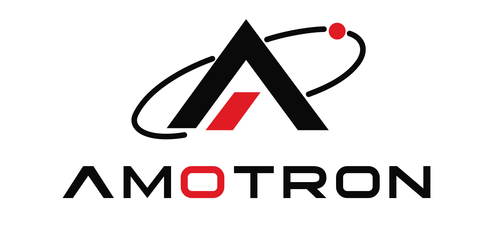
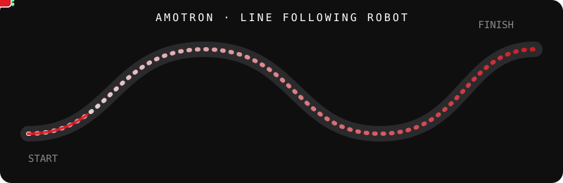
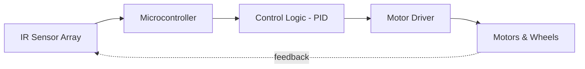
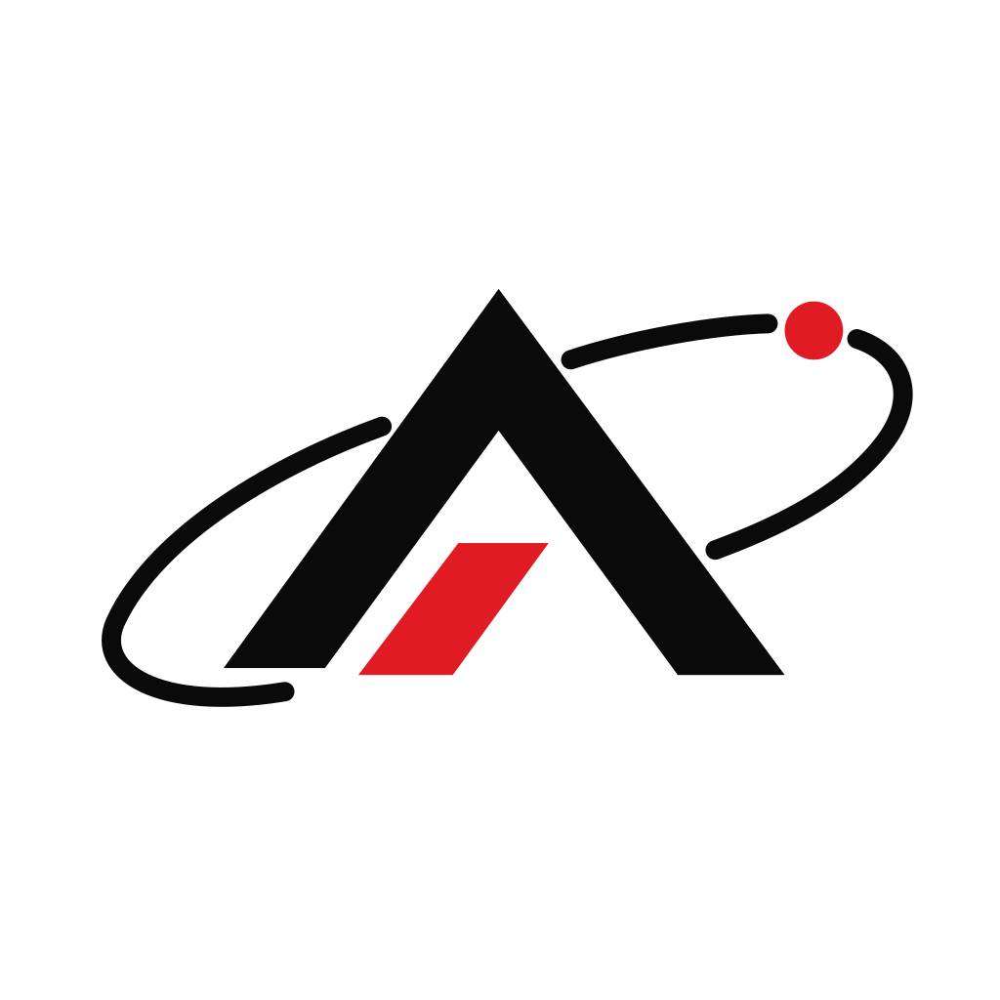

<!--
  ✏️ HOW TO USE
  1. Put this README.md and the `assets/` folder in the root of your repo (or your profile repo).
  2. Social / website links are intentionally EMPTY: fill the `()` after each badge, e.g. [](https://your-site.com)
  3. Progress bars: open assets/progress.svg and change the `to="..."` values + the "%" text.
  4. Typing text: open assets/typing.svg (4 lines) or just replace the text in it.
  5. Delete any badge or section you don't need.
-->

<div align="center">


<picture>
  <source media="(prefers-color-scheme: dark)" srcset="assets/amotron_logo_dark.svg">
  
</picture>

<br/>


<br/>

**Advanced · Mechanical · Operations · Technology & Robotics Oriented Network**

<br/>


<br/>

<!-- 🔗 Fill in your links inside the () -->
[]()
[]()
[]()
[]()
[]()
[]()
[]()
[]()
[]()
[]()

</div>


## 📖 Table of Contents

[About](#-about-amotron) · [Project](#-current-project-line-following-robot-lfr) · [Progress](#-live-progress) · [Team](#-team) · [Tech Stack](#️-tech-stack) · [Roadmap](#-roadmap) · [Gallery](#-gallery) · [Contact](#-get-in-touch)


## 🤖 About AMOTRON

<table>
<tr>
<td width="260" align="center">
  
</td>
<td>

**AMOTRON** is a student robotics team passionate about turning ideas into working machines. We design, build, test, and improve robots, and we are preparing to compete in robotics competitions.

| Letter | Meaning |
|:---:|:---|
| **A** | Advanced |
| **M** | Mechanical |
| **O** | Operations |
| **TRON** | Technology & Robotics Oriented Network |

</td>
</tr>
</table>


## 🏁 Current Project: Line Following Robot (LFR)

<div align="center">



</div>

We are building an **autonomous Line Following Robot** that can detect a track and follow it quickly, smoothly, and accurately.

### 🎯 Objectives

- 🔴 Develop a fully autonomous Line Following Robot
- ⚙️ Implement sensor-based line detection
- 💻 Improve control logic in C/C++
- 🔌 Work with embedded systems and electronic components
- 🏎️ Optimize speed, stability, and accuracy
- 🧪 Test, troubleshoot, and improve real-world performance

### 🧩 How It Works



### 🔧 Hardware & Components

<!-- Fill this in as you finalize your build -->

| Part | Details |
|:---|:---|
| Microcontroller | _to be added_ |
| Sensors | _to be added_ |
| Motor Driver | _to be added_ |
| Motors | _to be added_ |
| Power | _to be added_ |

<details>
<summary><b>💻 Sample control logic (PID skeleton, click to expand)</b></summary>

<br/>

A simplified Arduino-style skeleton to show the idea. Replace pins, sensor weights, and PID constants with your own after calibration.

```cpp
// Example only: tune every value on your own robot
float Kp = 0.0, Ki = 0.0, Kd = 0.0;   // set after calibration
int   baseSpeed = 150;
float lastError = 0, integral = 0;

int readLinePosition() {
  // return a value like -3 (far left) ... 0 (center) ... +3 (far right)
  // based on your sensor array
  return 0;
}

void loop() {
  int   error = readLinePosition();
  integral   += error;
  float pid   = Kp * error + Ki * integral + Kd * (error - lastError);
  lastError   = error;

  int leftSpeed  = constrain(baseSpeed + pid, 0, 255);
  int rightSpeed = constrain(baseSpeed - pid, 0, 255);
  setMotors(leftSpeed, rightSpeed);   // your motor driver function
}
```

</details>


## 📊 Live Progress

<div align="center">



</div>


## 👥 Team

<div align="center">

| Member | Role | GitHub |
|:---:|:---|:---:|
| **Abdulla-al-Noman Orko** | Robotics, Electronics & Programming | []() |
| **Mahir Sufian** | Robot Development & Team Collaboration | []() |
| **Ahammad Ibna Mazhar** | Robot Development & Team Collaboration | []() |

</div>


## 🛠️ Tech Stack

<div align="center">


</div>


## 📌 Roadmap

- [x] Team formation
- [x] Project planning
- [x] Initial research & design
- [ ] Robot assembly
- [ ] Sensor integration
- [ ] Programming & calibration
- [ ] Track testing
- [ ] Performance optimization
- [ ] Competition participation


## 📸 Gallery

<!-- Add your robot photos here, for example:
<p align="center">
  
  
  
</p>
-->

_Photos and demo videos coming soon._


## ❓ FAQ

<details>
<summary><b>What is AMOTRON?</b></summary>
<br/>
A student robotics team: <b>A</b>dvanced <b>M</b>echanical <b>O</b>perations + <b>T</b>echnology &amp; <b>R</b>obotics <b>O</b>riented <b>N</b>etwork.
</details>

<details>
<summary><b>What are you building right now?</b></summary>
<br/>
An autonomous Line Following Robot (LFR) for robotics competitions.
</details>

<details>
<summary><b>Can I collaborate or sponsor the team?</b></summary>
<br/>
Yes, please reach out through any of the links above.
</details>


## 🤝 Get in Touch

Want to collaborate, sponsor, or just say hi? Reach out through any of the links at the top of this page.

<div align="center">

<br/>



### **Building our ideas into reality, one circuit, one sensor, and one line of code at a time.**

<br/>

[]()
[]()
[]()
[]()
[]()

<br/>

⭐ If you like our work, give this repo a star ⭐

<br/>

© 2026 **AMOTRON** · All rights reserved


</div>
